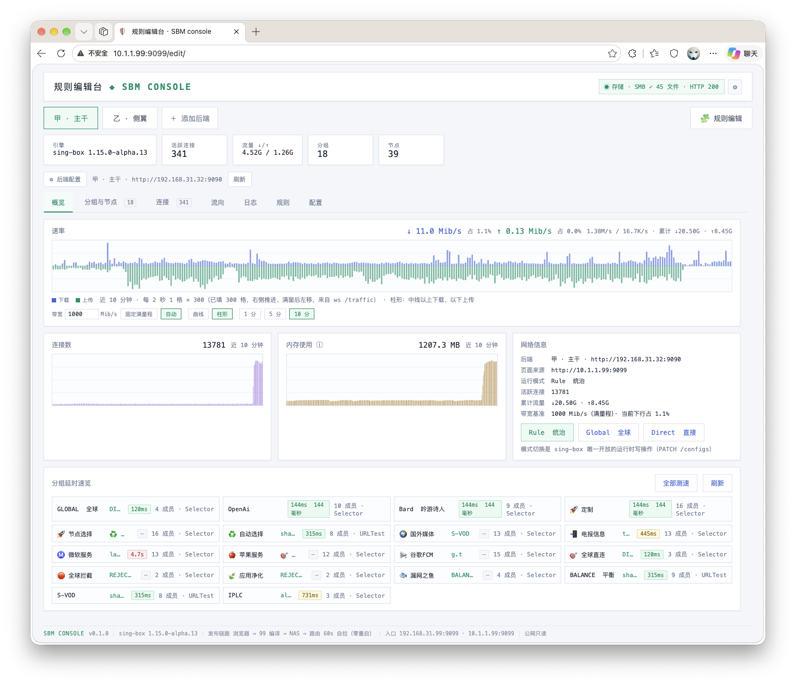

# SingBoxManager

多路由 **sing-box** 分流规则的托管仓库 + 内网管理台。

多台路由器的**全部域名/IP 分流规则**统一托管成 23 个远程 rule-set 桶放在 NAS 上：
改 NAS 文件 → 各路由 60 秒内自动拉取生效，**全程零重启**；规则的编辑、发布、节点切换、流量/连接/日志监控集中在一台内网**管理机**的管理台里，公网只保留只读页面。

> 本文所有主机名 / IP / 域名均为**示例占位**（`console.lan`、`router-a.lan`、`rules.example.com` 等），部署时替换为自己的真实地址；真实拓扑只记录在内部运维文档，不进本仓库。

首页：



---

## 架构

```
                          ┌──────────── NAS <规则桶目录> ─────────────────┐
   公网 (反向隧道/CDN)      │ index.html(脱敏首页)  rule-set/*.json|*.srs   │
        ─── 只读 ────────▶ │                                          ▲   │
                          └──────────────────────────────────────────┼───┘
                                                                     │ 编译产物写回
  浏览器 ── LAN / 虚拟内网 ─▶  管理机  vault-edit (Go, :9099) ◀────────┘
        (管理台 Angular 22)     │  GET  /edit/            前端静态（Angular 产物）
                                │  GET  /static/          Monaco 编辑器静态
                                │  GET  /rule-set/*       读 NAS（同源，免 CORS）
                                │  POST /publish          校验 → sing-box 编译 → 写 NAS
                                ▼
       路由 A sing-box ◀── remote rule-set, update_interval=1m ──▶ 路由 B sing-box …（可继续扩展）
```

- **写通道唯一**：规则编译需要 `sing-box` 二进制、写回需要 NAS 挂载，只有管理机同时满足，所以管理台与发布接口都放在管理机（`/publish` 用 `X-Vault-Key` 鉴权 + 仅内网可用）。
- **读通道**：NAS 上的 `.srs/.json` 由公网首页与路由直接拉取；管理台自己读 `.json` 源走同源接口。
- **多路由扩展**：新路由只要配置同一批远程 rule-set 的 URL，即可接入同一套规则源，无需改动本仓库。

## 组件

| 路径                     | 技术栈                                         | 作用                                                                                                                                                                           |
| ------------------------ | ---------------------------------------------- | ------------------------------------------------------------------------------------------------------------------------------------------------------------------------------ |
| `service/`             | Go 1.27（单二进制，单包多文件）                | `vault-edit`：静态页面 + `/rule-set/*` + `/publish` + `/router/*`；模块划分见 [docs/architecture.md](docs/architecture.md)                                              |
| `web/console/`         | Angular 22 + TypeScript 6（signals、zoneless） | 内网管理台：概览曲线、分组/节点、连接、日志、规则、Monaco 规则编辑                                                                                                             |
| `web/edit/index.html`  | 原生 HTML/JS（**已退役**）               | 上一代单文件管理台，仅作回滚参考，不参与部署                                                                                                                                   |
| `web/index.html`       | 原生 HTML/JS                                   | 公网首页（脱敏：只有桶卡片与体积/时间，无 IP/节点/拓扑）                                                                                                                       |
| `service/router_*.go`  | Go（在管理机上运行）                           | 路由配置通道：`router_store`（SSH 凭据 0600 存储）/ `router_ssh`（SSH 编排：读/check/备份/替换/重启/健康/回滚，**路由无需预装脚本**）/ `router_http`（鉴权与接口） |
| `scripts/`             | Bash                                           | 部署（`deploy_service.sh` / `deploy_console.sh` / `deploy_web.sh`）、体检（`check.sh`）、CLI 发布（`publish.sh`）                                                    |
| `docs/architecture.md` | 文档                                           | 代码架构：模块划分、两条写通道、凭据分层、前端状态流                                                                                                                           |
| `docs/runbook.md`      | 文档                                           | 运维手册：桶清单、路由配置口径、坑位、回滚表                                                                                                                                   |
| `docs/deploy.md`       | 文档                                           | 从零部署与升级的完整步骤                                                                                                                                                       |

## 关键地址（示例占位）

| 用途                     | 地址                                                           |
| ------------------------ | -------------------------------------------------------------- |
| 管理台（内网 LAN）       | `http://console.lan:9099/edit/`                              |
| 管理台（虚拟内网，可选） | `http://console-vpn.lan:9099/edit/`                          |
| 公网只读首页             | `https://rules.example.com/`                                 |
| zashboard（备选看板）    | `http://dash.lan:888/zashboard/`                             |
| 各路由 clash_api         | `http://router-a.lan:9090` / `http://router-b.lan:9090` … |

管理台两个入口等价；浏览器会**直连**路由的 `clash_api`，所以每台路由的
`access_control_allow_origin` 必须包含页面来源（精确 origin，不能写网段）：

```json
"access_control_allow_origin": ["http://dash.lan:888",
                                "http://console.lan:9099",
                                "http://console-vpn.lan:9099"]
```

## 快速部署

前置：macOS/Linux 开发机（Go 1.27+、Node 24+、`sshpass`），管理机（Debian，可 sudo），NAS 已挂到管理机的 `/mnt/hdd`，管理机上有 `sing-box` 二进制。

```bash
# 0) 只在本机导出，不写进仓库
export ROUTER_PW='<管理机 sudo 口令>'
export VAULT_KEY='<clash_api secret>' # 各路由 clash_api 的 secret

# 1) 后端（Go 二进制 + systemd，改服务端才需要）
scripts/deploy_service.sh

# 2) 前端（Angular 构建 + Monaco 静态；日常改页面只跑这个，不重启服务）
scripts/deploy_console.sh

# 3) 公网首页（改 web/index.html 才需要）
scripts/deploy_web.sh

# 4) 体检：管理台/公网/CORS/桶全绿
VAULT_KEY="$VAULT_KEY" scripts/check.sh
```

详细步骤（管理机一次性初始化、路由侧 CORS 与重启口径、回滚、FAQ）见 **[docs/deploy.md](docs/deploy.md)**。

## 日常操作

- **改规则**：管理台 → `🧩 规则编辑` → 选桶 → 编辑（Monaco）→ `保存并发布` → 各路由 60s 内自动拉取。
- **看/切节点**：管理台后端 tab → `分组与节点`（Selector 组可点切换，URLTest 组只读、按延迟自动选）。
- **看流量/连接/日志**：后端 tab → `概览`（下载/上传/连接数/内存曲线，1s 采样，可选 1/5/10 分钟窗口）、`连接`、`日志`。
- **改节点配置/重启**：后端 tab → `配置`（读 config.json、节点表、**按协议表单新增/编辑节点**、**删除带引用联动**、**ss/vmess/vless/trojan/hysteria2 分享链接导入**、Monaco 编辑整份配置、实时 diff 与结构校验、`校验` → `应用并重启`（约 1s 断流、失败自动回滚）、`重启 sing-box`）。链路：浏览器 → 管理机 `/router/*` → 受限 SSH → 路由本地 `singbox-apply`。
- **多后端**：`＋ 添加后端` 可挂任意 clash_api（名称/地址/密钥存本浏览器 localStorage）；地址没填=草稿，刷新即消失。
- **不用管理台时**：直接改 NAS `rule-set/*.json` 再编译成 `.srs` 也可以，见 `scripts/publish.sh` 与 runbook。

## 安全口径

- **仓库内无任何密钥**：`VAULT_KEY` 只经环境变量 → 落到管理机的 `/etc/vault-edit.env`（`0600`）；路由 secret 只在路由配置里。
- 管理台只监听内网；`/publish` 必须带 `X-Vault-Key`（= `VAULT_KEY`），缺失返回 401。`/router/*` 接受 `VAULT_KEY` **或**该路由 `clash_api` 认可的 secret（服务端向路由 `/version` 验证）——所以页面只需填你本来就有的 clash 密钥。
- 公网只暴露脱敏首页、rule-set 与 zashboard，**不含管理台**（`/edit/` 在公网是 404）。
- 凭据登记表在 NAS 的内部凭据文件（不入库）。
- 建议定期轮换 clash secret 与 `VAULT_KEY`（轮换时同步管理机的 env 与各路由配置）。

## 故障排查（最常见的 6 个坑）

| 现象                                           | 原因与处理                                                                                                      |
| ---------------------------------------------- | --------------------------------------------------------------------------------------------------------------- |
| 管理台后端页底部提示 401                       | 该后端密钥未填 → 顶部「发布密钥」或后端配置里填 `clash_api` secret                                           |
| `Failed to fetch` / 无 ACAO                  | 路由 `access_control_allow_origin` 没含**精确**页面来源（如 `http://console.lan:9099`，不能只写网段） |
| `/edit/` 白屏或 `main-*.js` 404            | 只覆盖了 `index.html`；必须整目录替换（`deploy_console.sh` 已处理，Go 侧 `/edit/` 有 SPA 回落）           |
| Monaco 编辑器不出来                            | 管理机上缺 `<STATIC_DIR>/monaco/vs`（`deploy_console.sh` 会自动铺）                                         |
| 虚拟内网（如 EasyTier）peer 表正常但 ping 不通 | 数据面被中间转发（如 Socat 的 `udp → tcp4` 误配）毒化，修法见 runbook                                        |
| 规则改了不生效                                 | 桶内容没变（按 hash 判定）/ 未过 60s 拉取窗口 / NAS 写回失败，看路由日志 `update rule-set <桶>`               |

更多坑位与回滚见 [docs/runbook.md](docs/runbook.md)。

## 目录结构

```
service/            Go 服务（单包多文件，go test ./... 有单测）
  main.go           入口 + 路由表 + /health
  config.go         环境变量与白名单常量
  httpx.go          JSON 应答 / CORS / preflight / 路径安全
  files.go          /edit/ /static/ /rule-set/ 三类静态服务
  publish.go        /publish：规则校验 → 编译 .srs → 写回 NAS
  router_store.go   路由 SSH 凭据存储与管理接口
  router_ssh.go     SSH 通道 + 远端编排（check/apply/restart/健康/回滚）
  router_http.go    /router/* 鉴权（VAULT_KEY 或 clash secret）与操作接口
web/console/        Angular 22 管理台
  src/app/          组件：app / backend-pane / overview / config-pane / rule-editor
                    服务：backends / clash / vault / router
                    纯函数：config-ops / node-form / share-link / line-diff / util
                    基建：area-chart（SVG 图表）/ monaco-editor（离线 Monaco）
web/edit/           已退役的单文件管理台（回滚参考）
web/index.html      公网只读首页
scripts/            deploy_service.sh / deploy_console.sh / deploy_web.sh / check.sh / publish.sh
docs/               architecture.md（代码架构）· runbook.md（运维手册）· deploy.md（部署手册）
HANDOFF.md          交接摘要
```

## 相关文档

- [docs/architecture.md](docs/architecture.md) —— 代码架构与模块划分
- [docs/deploy.md](docs/deploy.md) —— 部署/升级手册
- [docs/runbook.md](docs/runbook.md) —— 桶清单、路由配置口径、坑位、回滚表
- [HANDOFF.md](HANDOFF.md) —— 当前状态与待办交接
