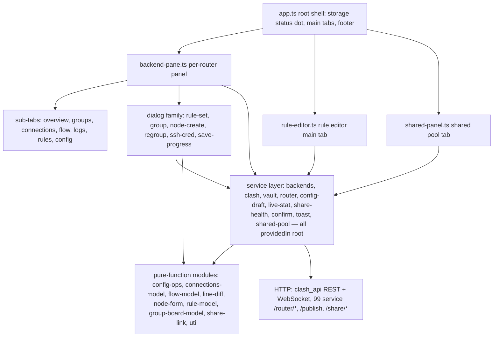
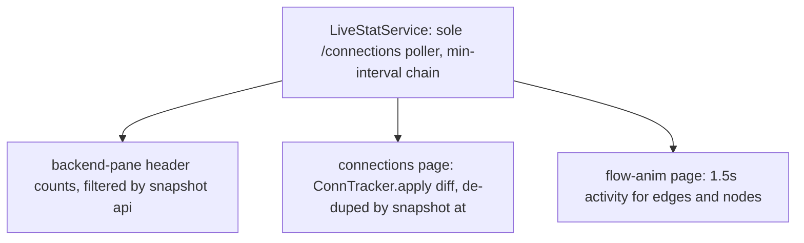
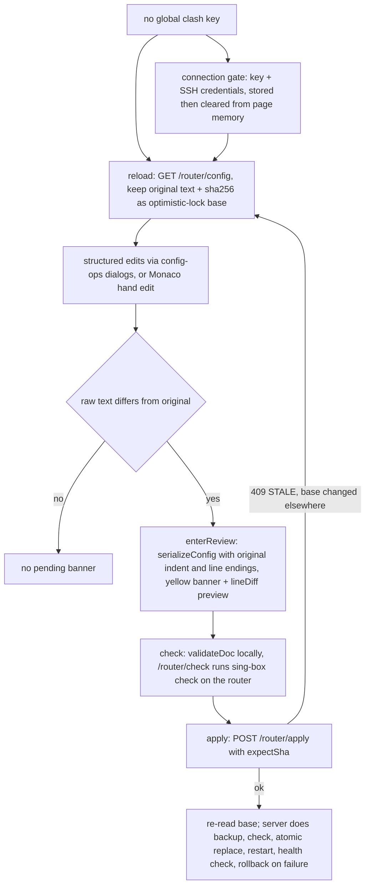

# Angular Console Architecture

The console lives in `web/console/` and is one of the three independently
releasable units (see [System Overview](overview.md)). It is an Angular 22
application built with **standalone components + signals + zoneless change
detection**, and it deliberately wires **no Angular Router**: the main tabs and
per-backend sub-tabs are plain signal switches (`app.config.ts`, `main.ts`,
`docs/architecture.md` §3).

The code base is organised in four layers, and the layering rule is strict:

| Layer | Files | Responsibility |
|---|---|---|
| Root shell | `app.ts` / `app.html` | Top bar (storage status dot + ⚙ gear), trust-origin banner, main tabs, footer |
| Per-router panel | `backend-pane.ts` / `.html` + child components | One instance per backend tab; owns the 7 sub-tabs and their clash_api interactions |
| Service layer | `*.service.ts` (all `providedIn: 'root'`) | HTTP boundaries, shared polling, cross-tab state |
| Pure functions | `config-ops.ts`, `connections-model.ts`, `flow-model.ts`, `node-form.ts`, `share-link.ts`, `line-diff.ts`, `group-board-model.ts`, `rule-model.ts`, `util.ts` | No Angular, no component state, unit-testable |
| Dialog family | `*-dialog.ts`, `confirm-dialog.ts`, `toast.ts`, `save-progress.ts` | Edit modals that only emit new documents; global confirm/toast replacing native dialogs |



*Layer map of the console: components depend on root services, services own the HTTP
boundaries, and all structured-logic lives in pure-function modules.*

## Root shell (`app.ts`)

`App` is the fixed 100dvh shell; scrolling only happens inside panels. It owns:

- **Main tab state** in the `active` signal: `'b<n>'` selects the n-th backend
  panel, `'edit'` the rule editor, `'pool'` the shared-pool panel. The
  `activeIndex` computed parses `/^b(\d+)$/` and clamps to the backend list, so
  a removed backend falls back cleanly (first backend, or `edit` when none).
- **Per-backend sub-tab memory**: the private `panes` signal maps backend index
  → `PaneTab`; `BackendPane` receives it as `initialTab` and reports changes
  back via the `tabChange` output, so switching away and back does not reset to
  the overview page. Memory is per index and resets to the default on page
  reload.
- **Storage status dot**: `ShareHealthService.start()` runs a `/share/health`
  probe every 30 s; the dot summarises file-channel (SMB/SFTP/local) plus
  public-URL health, clicking it re-probes immediately, and the ⚙ gear opens
  `ShareConfigDialog` (re-probe on `changed` close).
- **Origin trust banner**: `originOk` compares `location.origin` against
  `PAGE_ORIGINS` from `models.ts`; on mismatch the shell shows a banner telling
  the user to enter through a whitelisted origin, because the routers'
  clash_api CORS whitelist will block the requests anyway (see
  [Auth and CORS](../concepts/auth-and-cors.md)).
- **Footer**: console version (`CONSOLE_VERSION`) plus the sing-box version,
  probed via `ClashService.version()` for the first valid backend whenever the
  backend list changes.

Adding a backend is an in-memory draft (`bsvc.addDraft()`); the shell switches
to its tab immediately, and the ✎ marker on the tab reminds the user that a
draft disappears on refresh.

## Per-router panel (`backend-pane.ts`)

Each backend tab renders exactly one `BackendPane` instance. `app.html`
materialises the active index as a one-element `@for` array
(`@for (ai of [activeIndex()])`) with an explicit `ai !== null` guard (index 0
is falsy, so the guard must compare against `null`, not rely on truthiness) —
the in-template comment records why: iterating all backends with a nested
`@if` created the pane twice on every tab switch. The component header carries engine version, active-connection
count and traffic from the shared live snapshot, 401 / load-error banners, and
the ⚙ backend config form (`linkedSignal` fields for name/api/key).

The seven sub-tabs (`PaneTab`) are:
概览 overview · 分组与节点 groups · 连接 connections · 流向 flow ·
日志 logs · 规则 rules · 配置 config.

Per-tab side effects are centralised in `enterTab`:

- **logs** — the only place a log WebSocket is opened (`?token=` query auth,
  sing-box accepts nothing else); leaving the tab or destroying the pane closes
  it. The buffer keeps the last 300 lines, auto-scrolls only while the user is
  pinned to the bottom.
- **rules** — the runtime `GET /rules` table is lazy-loaded on first entry and
  rendered as a collapsed cross-check region under the rule-order table.
- **overview / connections / flow / config** — data acquisition belongs to the
  child components, which start on mount and clean up on destroy.

The pane also hosts the **global pending-save bar**: edits made by the flow-page
dialogs are staged in `ConfigDraftService` and stay visible across sub-tabs
until「保存并重启」. `runSave()` drives the `SaveProgressDialog`
(estimated step timing over one blocking apply call, failure classified to the
failing step with an actionable hint), and a missing-credential outcome flips
to `needCreds`, opens `SshCredDialog`, and auto-retries the save after
credentials are stored.

## Service layer (Injectable, all `providedIn: 'root'`)

| Service | Owns | Notes |
|---|---|---|
| `BackendsService` | Backend list + global key | localStorage keys `clashBackends` / `vaultKey`; draft backends are memory-only; `keyFor(b)` = per-backend key, falling back to the global key |
| `ClashService` | clash_api client | Browser connects to the router's 9090 directly; REST uses `Authorization: Bearer`, WebSockets use `?token=` because sing-box only reads the query parameter |
| `VaultService` | Rule-bucket I/O | `GET /rule-set/index`, fetch `.json`, HEAD `.srs`, `POST /publish` with `X-Vault-Key`; `validate()` is the front-end pre-check mirroring the server's key whitelist |
| `RouterService` | `/router/*` client | `X-Vault-Key` header carries `keyFor(backend)` (server accepts VAULT_KEY or that router's clash secret); `apply(config, expectSha)` is the optimistic-lock write |
| `ConfigDraftService` | Flow-page config draft | `load` → `originalText/originalSha/baseDoc`; `stage(doc)`; `save` = credential pre-check → `serializeConfig` → `apply(expectSha)` → re-read base (3 retries degrade to a warn, never a false "save failed") |
| `LiveStatService` | Sole `/connections` poller | see below |
| `ShareHealthService` | `/share/health` + storage config client | periodic probe, `configGet/configSave/probeWith/importToLocal`, and the public-rules preview/apply used by the storage dialog |
| `ConfirmService` | Confirm dialog state machine | `ask({...}) → Promise<boolean>`, queue-serialised |
| `ToastService` | Toast state machine | `show/ok/error`, auto-dismiss stack |
| `SharedPoolService` | Cross-backend node/rule pool | localStorage `sbm.sharedPool.v2`; `nodeFingerprint` = tag-stripped stable JSON |

### LiveStatService: one poller, many consumers

Before this service existed, the header statistics only refreshed while the
connections page was open, and per-page pollers duplicated requests. Now:

- `subscribe(backend, ms?)` registers a consumer; consumers on the same backend
  share one polling chain whose interval is the **minimum** across subscribers
  (header bar 2 s, connections page 2 s, flow page 1.5 s).
- Each snapshot carries `api` (which backend) and `at` (sample timestamp);
  consumers filter by `api` and de-duplicate by `at`, so signal replay cannot
  double-process a sample.
- The last unsubscribe stops the timer and clears `snap`; while
  `document.hidden` the fetch is skipped and a `visibilitychange` listener
  catches up immediately on return.
- Consumers: `backend-pane` (header counts), `connections.ts` (feeds its
  `ConnTracker` for rate/idle/closed diffing), `flow-anim.ts` (activity).



*One shared polling chain feeds the header bar, the connections table and the
flow animation.*

## Pure-function modules

These modules never touch Angular or component state; components call them and
render the results. This is what keeps the components thin and the logic
testable:

- **`config-ops.ts`** — the structured editor for the whole sing-box
  `config.json`: parse/serialize, `outbounds`/`endpoints`/`route.rules`/
  `route.rule_set` accessors, `addNode/updateNode/deleteNode` with
  `deleteImpact` analysis, `addGroup`, `addRuleSet` + `addRuleSetRef(s)` with
  `previewRuleSetRef`/`ruleInsertPoint` (domain rules before IP buckets, new
  refs before the final fallback rule), `moveRule`, `applyRuleGroups`/
  `applyRegroupRows` (the 拆解与合并 regroup engine), `pruneOrphanGroups`
  (keeps at least one group), `normalizeOutboundTags` (formatting: uppercase
  outbound tags with full reference rewriting), and `validateDoc`
  (front-end pre-check; the authoritative gate remains `sing-box check` on the
  router).
- **`connections-model.ts`** — `ConnTracker.apply` diffs adjacent snapshots
  into rate/idle/closed rows (closed connections kept up to `CLOSED_LIMIT`
  500), regex search (space-separated AND terms, field OR, invalid regex
  degrades to literal), sort/group/column definitions.
- **`flow-model.ts`** — the six-column flow engine (`FLOW_COLS` pc → router →
  rule → group → node → cloud): `buildStatic` parses config into tiles/groups/
  node rows, `buildFlow` merges live connections, layout and activity stepping
  are separate pure functions.
- **`group-board-model.ts`** — `readBoard` / `moveMember` for the drag board;
  never mutates the input doc, clones via `structuredClone` first.
- **`rule-model.ts`** — `readRuleModel` / `filterRouteRules`: read-only
  summaries of `route.rule_set` and `route.rules` (restart semantics:
  remote bucket content changes are restart-free, structural rule edits are
  not).
- **`node-form.ts`** — flat form model; `buildNode` validates per protocol and
  assembles the outbound object, returning `ok/error`; `formFromNode` flattens
  an existing outbound back into the form.
- **`share-link.ts`** — `parseShareLinks`: ss/vmess/vless/trojan/hysteria2/socks
  URIs (batch, base64 URL-safe tolerant) → outbound objects.
- **`line-diff.ts`** — LCS row diff for the staged-changes preview: caps the DP
  matrix at 4,000,000 cells (beyond that, detail lines are dropped rather than
  freezing the UI), returns at most 60 detail lines but full add/del counts.

### The `serializeConfig` invariant

Every structured edit funnels through one function:

```ts
export function serializeConfig(doc: ConfigDoc, like: string): string {
  const crlf = like.includes('\r\n');
  const indent = detectIndent(like); // probe: width of line 2's leading spaces, default 2
  let out = JSON.stringify(doc.root, null, indent);
  if (crlf) out = out.replace(/\n/g, '\r\n');
  return out + (like.endsWith('\n') ? (crlf ? '\r\n' : '\n') : '');
}
```

`serializeConfig(doc, originalText)` re-serialises the edited document using
the **original file's indentation width, CRLF/LF line endings and trailing
newline**. This is the key invariant for structured edits: a dialog that only
adds one group member produces a diff containing exactly that change, instead
of re-formatting the whole file. Both staging paths use it —
`ConfigPane.enterReview` and `ConfigDraftService.save` — and the residual diff
noise is limited to hand-tightened lines being normalised.

## Dialog family

Two kinds of dialogs exist, and they follow different rules.

**Edit/create dialogs** (rule-set ③, group ④, node-create ⑤, rule-set-create,
group-create, rule-regroup, save-progress) never write back themselves. They
take a base `ConfigDoc` input, clone, apply pure-function edits, and emit a
**new document** through `docChange` (rule-set-create may read
`/rule-set/index` to pick existing bucket tags, but the write path is still the
host's staging chain). The host decides the staging chain:

- flow page (③④⑤ column「＋」buttons and edit cards) → `ConfigDraftService.stage`
  → the cross-tab pending bar →「保存并重启」;
- config page → `ConfigPane.enterReview` → serialized text + diff review →
  「应用并重启」.

`node-create-dialog` is shared verbatim by the flow page's ⑤ column and the
config page, with two entry tabs: the structured form (`node-form.ts`) and
batch share-link import (`share-link.ts`), both with group-membership
checkboxes. `rule-set-create-dialog` writes definition **and** reference in one
step (`config-ops.addRuleSet` + `addRuleSetRefs`) but intentionally does not
create NAS bucket files — it looks the buckets up via `/rule-set/index` and
tells the user to create and publish them in the rule editor first.

**Global interaction dialogs** replace the natives:

- `ConfirmService.ask({title, body, details, danger}) → Promise<boolean>` keeps
  the old `confirm()` call shape but queues concurrent requests and settles
  each promise independently. The reason it exists: browsers let users "block
  this page from creating more dialogs", after which native `confirm()`
  silently returns `false` — dangerous for destructive operations.
  `ConfirmDialog` renders it on a native `<dialog>` + `showModal()` (top-layer
  focus constraint, ESC and backdrop-click both cancel), reusing the `.modal`
  styling; danger prompts focus the cancel button.
- `ToastService.show/ok/error` replaces `alert()` with a non-blocking
  bottom-right stack (click to dismiss, auto-dismiss; errors stay 6.5 s).
  Both are mounted once in `app.html` and driven only by their services.

## Config sub-page state flow

The 配置 sub-page (`config-pane.ts`) is the textual editor and the host of the
structured panels. Its lifecycle is a strictly staged pipeline:



*The config sub-page pipeline: read → stage → review → check → apply with an
optimistic lock. The server side of apply is documented in
[Router Config Apply](../workflows/router-config-apply.md).*

Key semantics to preserve when changing this page:

- `pending` is purely `raw !== original`; every structured panel bases its edits
  on `origDoc` (parsed from the last-read original, stable across staging) and
  hands a fresh `ConfigDoc` to `enterReview`, so repeated drags never drift.
- `apply()` blocks on JSON syntax errors outright; `validateDoc` issues are
  listed in a danger confirm (the router-side check remains the authority).
- `expectSha` makes concurrent edits safe: if someone else applied a config in
  between, the server answers 409/STALE and the user must re-read.
- Formatting (`normalizeOutboundTags` + 2-space re-indent) only touches the
  staging area; bucket tags (`route.rule_set[].tag`, which map to NAS file
  names) are never rewritten.

## Rule editor main tab

The 🧩 规则编辑 tab (`rule-editor.ts`) edits the NAS rule buckets, not the
router: the file tree is the live `/rule-set/index` listing (only buckets with
a `.json` source are shown; `.srs`-only compile artifacts are hidden), names
must match `^(rs-[a-z0-9-]+|bard-domains)$`, and Monaco (language json,
strict JSON diagnostics, no comments) is the editor. Publishing posts to
`/publish`; the server validates, compiles `.srs`, writes both files back to
the bucket, and the routers pull the remote rule-set on their ~60 s cycle with
zero restart. The bucket switch confirms discarding unpublished edits;
create/rename/delete confirm through the same confirm dialog.

## Build & deployment facts

- Build command is `npx ng build --base-href=/edit/` (deploy script step 1);
  production config sets `outputHashing: "all"`, so the output is a set of
  hashed files (`main-<HASH>.js` …). The deploy replaces the whole remote
  directory (backup → wipe → extract) because overwriting only `index.html`
  would break hashed asset references.
- The deploy ships the page to `/usr/local/share/vault-edit/edit/` on the admin
  host and vendors Monaco 0.57.0 from `npm pack` `min/vs` into
  `/static/monaco/vs` (skipped when the remote `VERSION` file already
  matches). `monaco-editor.ts` loads the AMD loader from `/static/monaco/vs`
  at runtime — fully offline, no npm monaco and no CDN. Post-deploy checks:
  `/edit/` 200, `/static/monaco/vs/loader.js` 200, the hashed entry js 200,
  `/publish` without key 401.
- `models.ts` constants are load-bearing across the boundary:
  `CONSOLE_VERSION` (footer, manually bumped per release), `PAGE_ORIGINS`
  must equal the Go service's `allowOrigins` in `service/config.go` and the
  routers' clash_api CORS whitelist, and `LAT_LOW/LAT_MID` (400/800 ms) are the
  single latency threshold pair consumed by `util.latClass` and `flow-model`.
  Change them in one place, never inline.

## Dedup convergence points

A recurring refactor theme (architecture doc §3.3) is that shared helpers live
in dedicated modules and components consume them, rather than re-implementing
per component:

| Before | Now |
|---|---|
| byte formatting duplicated in overview / backend-pane / vault.service | `util.fmtBytes` (single B/K/M/G scheme) |
| latency classing + thresholds duplicated in two components | `util.latClass/latText` + `models.LAT_LOW/LAT_MID` |
| hand-written concurrency pool in two places | `util.runPool` (concurrency 6) |
| diff algorithm embedded in config-pane (~638 lines) | `line-diff.ts` |
| form validation/assembly embedded in config-pane | `node-form.ts` (`buildNode` returns ok/error; the component only displays) |
| rule reorder only as raw JSON edits | `config-ops.moveRule` + ↑↓ panels; new refs get `ruleInsertPoint`/`previewRuleSetRef` |

**Convention for new features:** extend `util.ts`, `line-diff.ts`,
`node-form.ts` and `config-ops.ts` instead of adding a private copy inside a
component. Component files should shrink to state wiring + rendering; if a new
helper is needed by two components, it belongs in a pure module (which also
makes it reachable by the ops tests below).

## Focused tests

`npm run test:ops` (`test/run-ops-tests.mjs`) bundles `config-ops.ts` and
`shared-pool.service.ts` to ESM with esbuild, then runs the assertion modules
in `test/ops/*.mjs` (fingerprint, pool nodes/rules/override, group-apply,
cond-merge, string-rule-set). Fixture-dependent cases
(`test/ops/fixtures/router-32.json`, which contains real node secrets and is
not committed) are skipped when absent. There are no component-level unit
tests; the acceptance loop for UI behaviour is a real-browser pass through
gate → read → edit → stage → check → apply → revert after deployment, plus
`scripts/mock_clash.mjs` for data-shape-heavy pages like the connections
browser without a real router (see [Verification](../testing/verification.md)).

## Related pages

- [Auth and CORS](../concepts/auth-and-cors.md) — how `PAGE_ORIGINS`,
  `X-Vault-Key` and clash secrets gate the console's calls.
- [Console Data Flow](../workflows/console-data-flow.md) — end-to-end data
  paths behind the pages described here.
- [Router Config Apply](../workflows/router-config-apply.md) — the server-side
  orchestration that `/router/apply` triggers.
- [Verification](../testing/verification.md) — test and acceptance procedures.
